# Week 11 Draft: Visualisation, Interaction and Website Design

*Team Loong · COS30045 · Draft for Design Book sections 3.1–3.3 and the coding plan. Each design is drawn as a flowchart (Mermaid, which renders on GitHub and in VS Code's Markdown preview).*

---

## 3.1 Website Design

### Site structure
The site is a single scrolling page that tells one story, *"Who ends up in hospital?"*. The Overview states the audience and purpose once. Each dataset then tells its own story with 4–5 charts.

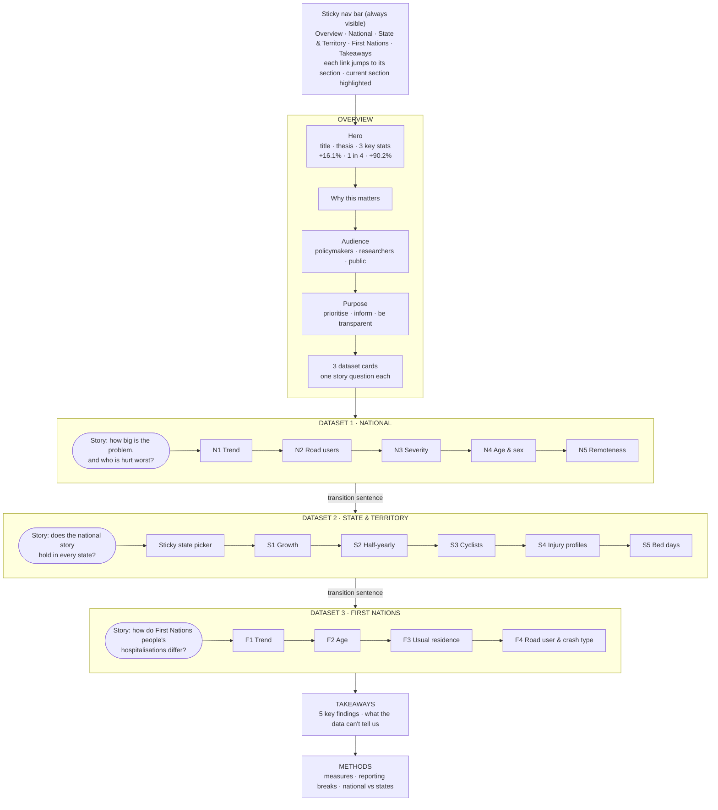

### Chart block layout
All 14 charts use the same block, so readers learn how to read the page once.

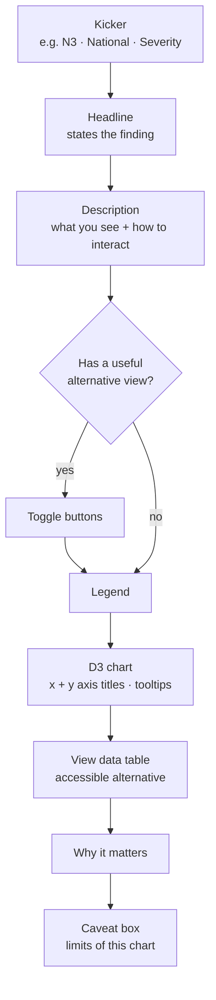

### Responsive layout

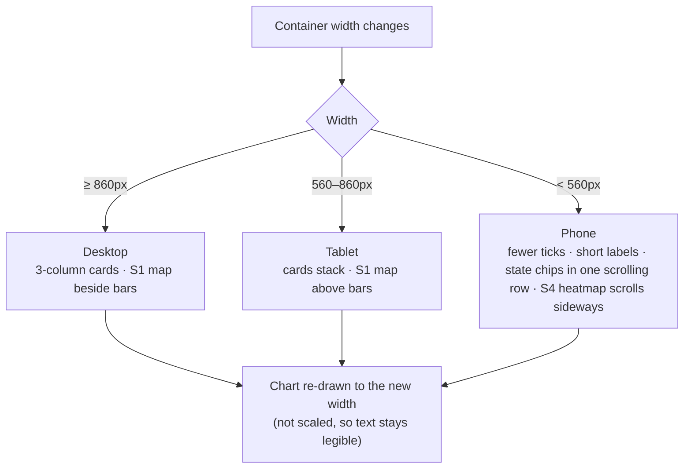

**Style:**
- **Fonts:** Source Serif 4 for headlines, Inter for body and chart text.
- **Background and widths:** warm off-white background; text column 720px, wide charts 1040px.
- **Contrast:** all text at least 4.5:1.

---

## 3.2 Visualisation Design

### How each chart was designed

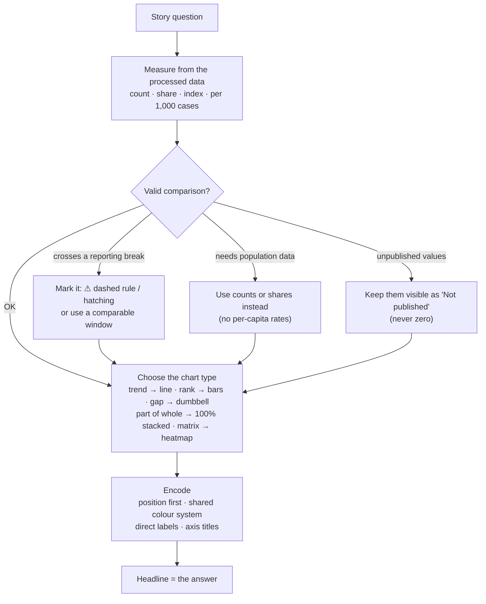

### Dataset 1: National

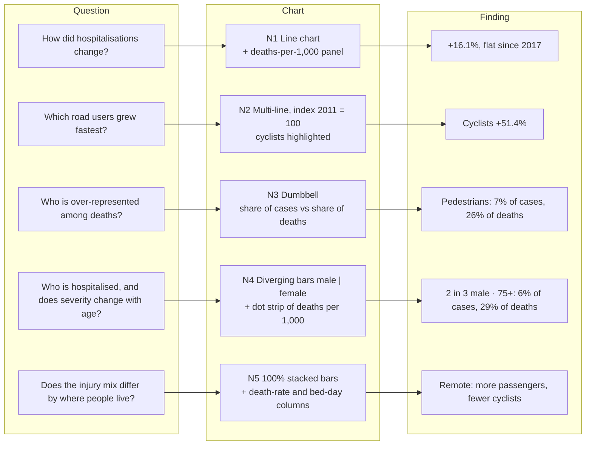

### Dataset 2: State & Territory

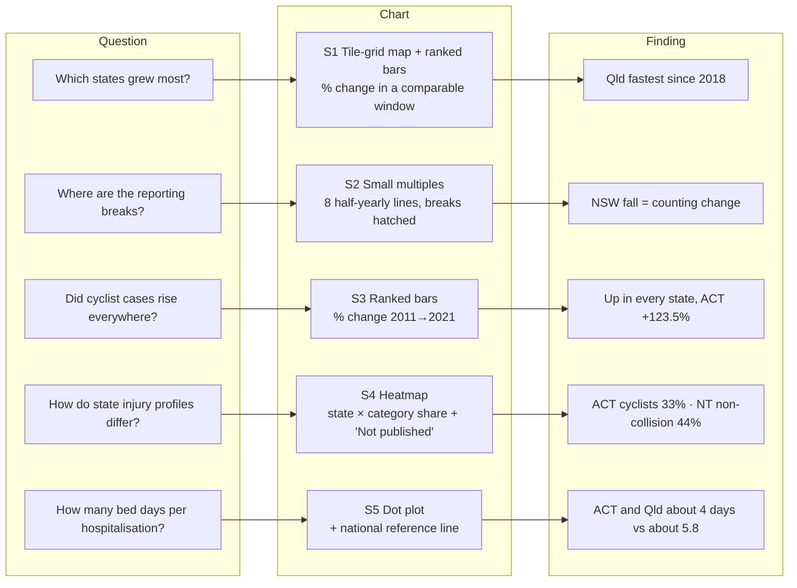

### Dataset 3: First Nations

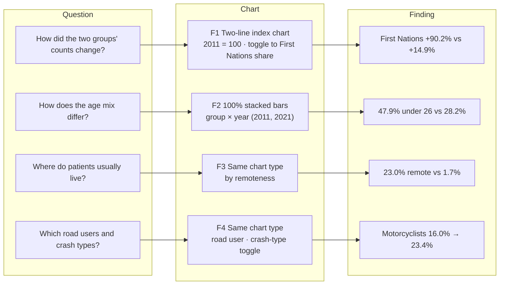

### Colour system

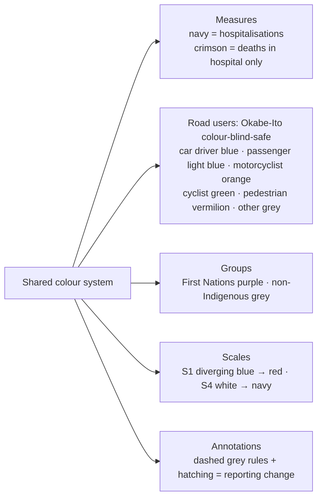

---

## 3.3 Interaction Design

### Reader journey

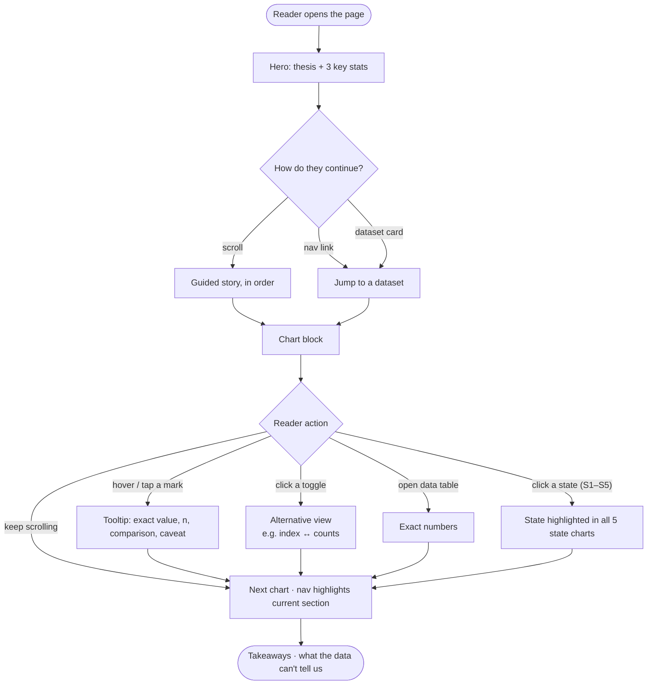

### Toggle interaction (N1, N2, N3, S1, S2, S4, F1, F4)

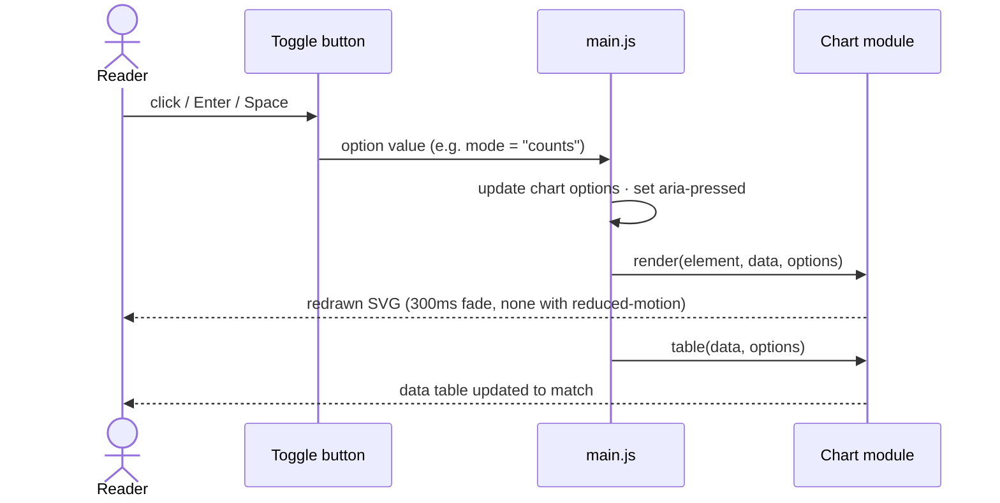

### Linked state highlighting (S1–S5)

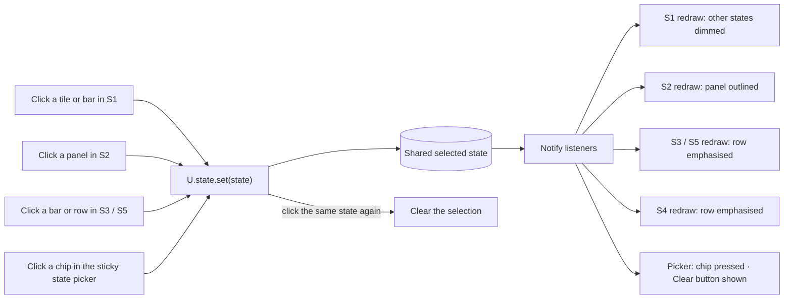

### Chart-specific interactions

| Chart | Interaction |
|---|---|
| N1 | Half-yearly / annual toggle · crosshair tooltip with the change from the previous period |
| N2 | Index / counts toggle · legend buttons bring any road user to the front |
| N3 | Road user / "what the crash involved" toggle · tooltip with deaths n |
| N5, F2–F4 | Hovering a segment dims other categories · tooltip compares the other year and the other group |
| S1 | Comparison-window toggle: 2018–21, 2012–16, 2011–21 |
| S2 | Own / shared y-scale toggle · crosshair lines up the same half-year in all 8 panels |
| S4 | Category toggle · "Sort by" chips reorder the states |
| F1 | Index / First Nations share toggle · crosshair tooltip |

**Accessibility:**
- Every chart has `role="img"` and an `aria-label` that states its finding.
- All controls are keyboard-operable buttons using `aria-pressed`.
- Focus is kept when a chart redraws.
- The data tables repeat everything that tooltips show.

---

## Plan for coding

### Data pipeline

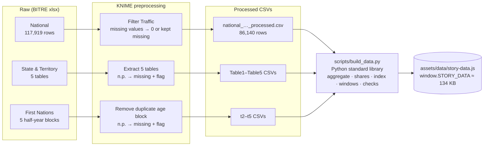

**Why the data loads through a `<script>` tag rather than `d3.csv()`:**
- The page works when opened directly from disk, where `fetch` is blocked.
- The browser never parses the 86k-row file.
- Re-running the script updates every chart and every number in the page text.

### Page loading and chart mounting

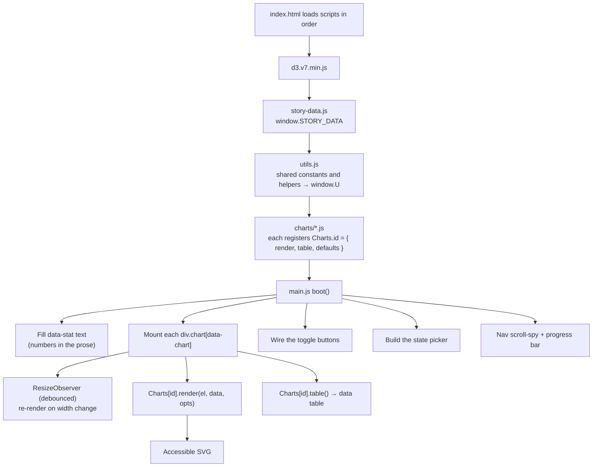

### Shared constants and helpers (`utils.js`)

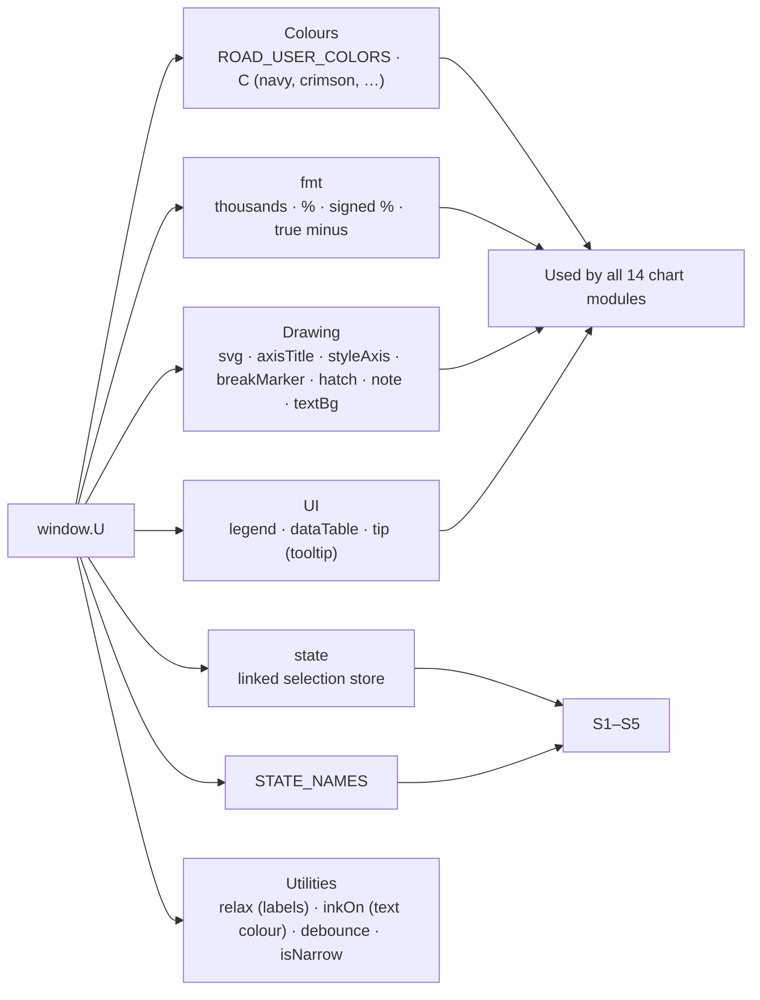

### Status and next steps

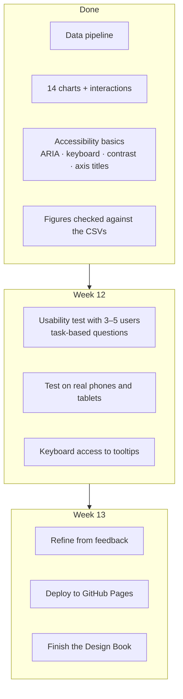
